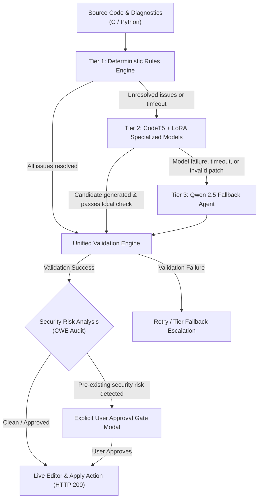

# System Architecture: Multi-Tiered Neural-Symbolic Repair Pipeline

## 1. Overview & High-Level Architecture

The Antigravity Repair Pipeline implements a robust, multi-tiered neural-symbolic program repair and compiler-assisted security remediation engine. The architecture adheres to zero-fabrication, deterministic guarantees, strict scope preservation, and end-to-end user transparency.

---

## 2. Pipeline Execution Tiers

### Tier 1: Deterministic Rules Engine
- **Purpose**: Rapid, mathematically sound syntactic, semantic, and security repairs using rule-based transformations.
- **Components**:
  - *Lexical & Syntactic Correctors*: Handles misplaced or missing punctuation (`;`, `)`, `}`), keywords (`cahr` -> `char`), and operator splitting (`+ =` -> `+=`).
  - *Identifier Typo Corrector*: Levenshtein and scope-aware symbol table matching for undeclared identifiers.
  - *Deterministic Security Rules*: Safe replacement of unbounded functions (e.g. `gets()` -> `fgets()`), scope-sensitive bounded `scanf` width specifiers (`scanf("%s", buf)` -> `scanf("%99s", buf)` based on local array capacity), and format string defenses.
- **Exit Condition**: If Tier 1 repairs all diagnostics and produces an independently valid compilation unit, the pipeline bypasses AI tiers, minimizing energy consumption and latency.

### Tier 2: CodeT5 + LoRA Specialized Models
- **Purpose**: Local neural repair specialized in structured code editing and multi-line syntax/semantic error correction.
- **Model Configuration**: Fast sequence-to-sequence model fine-tuned with Low-Rank Adaptation (LoRA) for C/Python repair tasks.
- **Fallback Triggers**:
  - Execution time budget exceeded (timeout threshold).
  - Out of memory (OOM) or inference failure.
  - Candidate rejected by the validation engine (compiler errors, AST corruption, or semantic regression).

### Tier 3: Qwen 2.5 Fallback Agent
- **Purpose**: Large-scale language model fallback capable of deep structural reasoning, multi-function coordinate planning, and intricate semantic repairs.
- **Context Injection**:
  - Original source code and line numbers.
  - Exact compiler diagnostics (GCC / Clang / Python AST trace).
  - Security vulnerability annotations (CWE IDs, sink/source trace, tainted variables).
  - Previous tier failure explanations to prevent repeat errors.
- **Constraints**: Qwen generates minimal, non-renaming diffs constrained by scope boundaries.

---

## 3. Validation & Epistemological Safety Mechanisms

### Unified Patch Validator (`compiler/patch_validator.py`)
Every repair candidate generated by any tier must pass through the independent validation engine before reaching the user or editor:
1. **Compilation Check**:
   - For C: `gcc -Wall -Wextra -std=c11 -c` (warnings allowed, errors strictly rejected).
   - For Python: `py_compile` / `ast.parse` syntax verification.
2. **Project Parser Parity**:
   - C files must cleanly parse under ANTLR `SimpleCParser` with zero syntax error listener events.
   - Python files must successfully build a valid AST.
3. **Semantic Integrity Check**:
   - Types, function signatures, and return values are verified against symbol table declarations.
4. **Program Meaning Preservation**:
   - Meaning is strictly preserved: identifiers are never arbitrarily renamed unless explicitly diagnosed as an unknown typo.
   - Punctuation (such as `;`) is placed at the end of the intended statement line.
   - Control structure headers (`for`, `if`, `while`, `switch`) never have trailing commas injected.

### Scope Guard (`compiler/patch_validator.py`, `compiler/security_auto_fixer.py`)
- **Scope Invariant**: Edits are restricted to lines containing diagnostics or findings, within an enclosing block/function window.
- **Scope Rejection**: If an AI candidate touches unrelated functions or lines far from any reported issue, the patch is rejected to prevent hallucinated side effects.

### Scope-Sensitive Security Remediation (`compiler/scanf_analyzer.py`)
- Array declarations often reuse common variable names (`cmd`, `buf`, `arr`).
- Buffer capacity resolution searches backwards from the unsafe call line within the enclosing function boundary rather than matching the first global declaration in the file.
- Format specifiers are calibrated to `sizeof(buffer) - 1` with single null-terminator preservation.

---

## 4. User Approval Gate & Pre-Existing Security Findings

When a program contains pre-existing security risks (such as `system()` command execution or legacy architectural patterns):
1. **Non-Blocking Assessment**: The pipeline does not fail compilation or abort validation if the risk was already present in the baseline code and not introduced by the patch.
2. **Risk Categorization**: Findings are recorded as `remaining_risks`.
3. **Explicit User Approval**: The UI surfaces the Security Gate Modal (`#security-approval-modal`), detailing the CWE, line number, source-to-sink flow, and mitigation recommendation.
4. **Approval & Apply**: The user can review the risk and click "Approve and Apply" (`#sec-btn-approve`), which atomically updates the editor and issues HTTP 200 via `/api/improvement/candidate/<id>/apply`.

---

## 5. Primary Indicators & Telemetry Metrics

The system displays 6 primary indicators reflecting code health, green energy footprint, and repair benchmarks:
1. **Overall Code Quality %** (`[COMBINED]`): Composite metric: `50% Quality + 25% (100 - Optimization) + 25% (100 - Vulnerability Risk)`.
2. **Optimal Code %** (`[HEURISTIC]`): Optimization potential heuristic based on dead store elimination, loop invariants, and algorithmic simplification.
3. **Poor Code %** (`[INVERSE Q]`): Direct inverse of Overall Code Quality (`100 - Overall`).
4. **Vulnerability Risk %** (`[RISK INDEX]`): Calibrated static risk index derived from CWE severity, exploitability, and confidence factor (0% for clean code).
5. **Green Metrics** (`[ESTIMATED TDP]`): Energy consumption model computing total execution runtime (ms), memory footprint (MB), and estimated energy (Joules).
6. **Model Accuracy & Repair** (`[BENCHMARKED]`): Empirical benchmark score of the active multi-tier repair pipeline (Rules -> CodeT5 -> Qwen).
